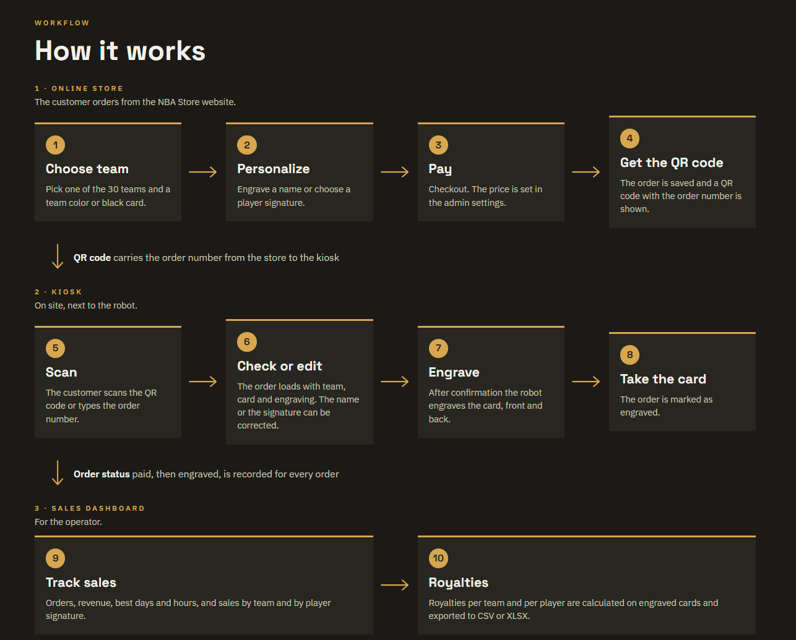

# CraftoBotics Card Experience

Interactive demo of the CraftoBotics personalized card experience: a customer designs and orders an engraved card online, then collects it at an on-site kiosk where a robot engraves it.

**Live demo:** https://z0u8ir.github.io/nbastore-demo/

 ## How it works

The demo covers the full journey in three parts, all in one page.

### 1. Online store

The customer orders from the store website.

- **Choose a team** from the 30 teams, with a team color or black card.
- **Personalize** by engraving a name or choosing a player signature.
- **Pay** through a simulated checkout (no real payment is taken).
- **Get a QR code** carrying the order number, which can be downloaded.

### 2. Kiosk

On site, next to the engraving robot.

- **Scan** the QR code, or type the order number.
- **Check or edit** the order: the name or signature can be corrected before engraving.
- **Engrave**: after confirmation the robot engraves the card, front and back.
- **Collect** the card; the order is marked as engraved.

### 3. Sales dashboard

For the operator.

- **Sales tracking:** orders, revenue, best days and hours, sales by team and by player signature.
- **Order management:** filters, bulk status changes (paid, engraved), deletion, and CSV export with selectable columns.
- **Royalty reports:** royalties per team and per player, calculated on engraved cards only, exported to CSV or XLSX (one summary sheet plus one sheet per team or player).

## Notes

- This is a demo. Payments are simulated and orders are stored only in your browser (localStorage), so each visitor sees their own data.
- Team names, logos and signatures are shown for demonstration purposes only.

© 2026 CraftoBotics SAS. All rights reserved.
